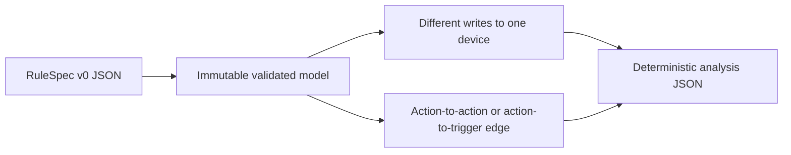

# SmartRule-Conflict-Analyzer

A research repository for detecting interactions among IoT automation rules. It includes historical Apriori experiments, real-user and IFTTT matchers, synchronization simulations, and a small deterministic analyzer for conflict and dependency inspection.

> **Research status:** the governed CLI is reproducible and covered by tests. Historical experiments depend on datasets, devices, databases, or services that are not distributed with this repository and are not part of the supported path.

## What the analyzer detects

The deterministic path retains two core ideas already present in the research code:

- **Write conflict:** two rules assign different states to the same action device.
- **Dependency:** an earlier rule's action device is used by a later rule as an action or trigger device.

Rules that write the same state are not reported as conflicts. Dependency direction follows fixture order, producing a directed acyclic graph for the supplied example.



## Run the reproducible demo

The supported analyzer uses only the Python standard library and Python 3.9+.

```bash
python -m unittest discover -s tests -v
python -m smart_rule_analyzer.cli examples/rulespec-v0.json
```

The result can be reproduced against the checked-in expectation:

```bash
python -m smart_rule_analyzer.cli \
  examples/rulespec-v0.json \
  --output analysis.json
python -c 'import json; assert json.load(open("analysis.json")) == json.load(open("examples/expected-analysis.json"))'
```

The fixture contains both conflict and no-conflict cases, a real action-to-trigger chain, and an independent rule.

The test suite also executes the repository's original Apriori implementation against a small redistributable transaction set, checking known support, confidence, and candidate pruning. The historical algorithm remains intact rather than being replaced by the compact analyzer.

## RuleSpec v0

```json
{
  "id": "close-curtain",
  "description": "Close the curtain when rain is detected",
  "triggers": [{"device": "weather", "state": "rain"}],
  "conditions": [],
  "actions": [{"device": "curtain", "state": "closed"}]
}
```

All five fields are required. Unknown fields are rejected, rule IDs must be unique, and the Python model is frozen after parsing. The shape is intentionally small enough to adapt both the scheduler and the historical analyzer formats.

## Repository map

- `smart_rule_analyzer/` — supported deterministic model, analyzer, and CLI.
- `examples/` — redistributable fixture and expected result.
- `Detector/Apriori/` — historical association-rule and dataset-generation experiments.
- `Detector/Matcher/` — real-user and IFTTT matching research.
- `Detector/Vulnerability/` — historical vulnerability counting and graph analysis.
- `Synchronizer/` — condition-variable, monitor, critical-section, and LLSC simulation experiments.

`requirements-research.txt` pins the third-party packages imported by historical experiment families. Installing those packages does not supply their missing private datasets or external infrastructure.

The research pins target Python 3.11. The governed standard-library analyzer supports Python 3.9 and later independently of that optional stack.

## Safety and portability changes

Executable `eval` calls in active analysis scripts were replaced with `ast.literal_eval`. The supported CLI uses JSON only. The portable example does not contain user records, credentials, or absolute machine paths.

Legacy database, Redis, and device-control experiments no longer contain connection literals. They require explicit `SMART_RULE_MYSQL_*`, `SMART_RULE_REDIS_*`, or `SMART_RULE_DEVICE_*` environment variables and remain outside routine tests. Historical credentials, if they were real, must be assessed and rotated or revoked by their owner because removing them from the current tree does not remove them from Git history.

## Limitations

- The compact analyzer implements device-state conflicts and dependency edges; it does not claim to cover every vulnerability category in the historical studies.
- Conditions are validated and retained but are not interpreted by the compact analyzer.
- Historical scripts have uneven interfaces and may require unavailable datasets, MySQL, Redis, or device access.
- The checked-in demo is functional evidence, not a performance benchmark or production validation.

## License

No open-source license has been selected yet. Copyright remains with the repository owner; reuse is not granted until a license is added.
