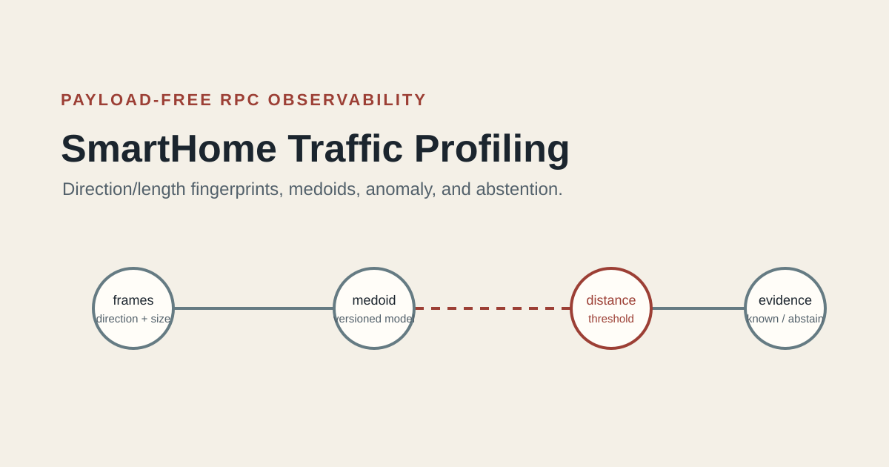
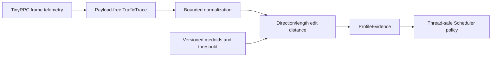

# SmartHome-Traffic-Profiling

A deterministic research toolkit that turns payload-free, application-instrumented TinyRPC frame traces into scheduling evidence. It profiles frame direction and encoded length, chooses reproducible medoids, measures edit distance, and explicitly reports known, anomalous, ambiguous, and unknown traffic shapes.

The profiler is the observation layer of the Smart Home Edge Computing System. It runs before a device action: TinyRPC emits a trace, this component creates `ProfileEvidence`, and the scheduler uses that exact evidence to proceed, reorder, defer, or abstain.



## Verified behavior

- Requires a bounded `modelInputVersion` and strictly accepts `instrumented-rpc` and `synthetic-fixture` sources; the integration path requires the former.
- Rejects payload fields, private metadata, unordered time offsets, oversized frames, excessive observations, and excessive aggregate bytes.
- Trains one deterministic medoid per label and binds the training material, model, and output with SHA-256 hashes.
- Uses a declared symmetric Levenshtein distance over ordered `(direction, encodedFrameLength)` features.
- Emits byte-stable evidence for a fixed trace, model, and timestamp.
- Marks above-threshold traces as anomalous and equal nearest matches as ambiguous. Neither is forced into a known label.
- Retains the existing RuleSpec conflict/dependency analyzer and validates the original Apriori support/confidence behavior.

## Run

Python 3.9+ and the standard library are sufficient for the supported path.

```bash
python -m unittest discover -s tests -v
python -m smart_rule_analyzer.model_cli \
  --training examples/training-traces-v1.json \
  --output /tmp/profile-model-v1.json
python -m smart_rule_analyzer.profile_cli \
  --trace examples/instrumented-trace-v1.json \
  --model examples/profile-model-v1.json \
  --output profile-evidence.json \
  --produced-at 2026-01-01T00:00:00Z
```

The demonstration trace is a sanitized contract fixture shaped like instrumentation output. System acceptance separately supplies a trace emitted by an actual TinyRPC loopback invocation before any action.

The trace envelope and every full payload-free observation follow the Hub's corrected `TrafficTrace` `1.0.2` contract. `modelInputVersion` identifies the bounded feature-input format; all observations must share the envelope's schema version and trace ID and bind one session/request pair.

The earlier rule analyzer remains available:

```bash
python -m smart_rule_analyzer.cli examples/rulespec-v0.json
```

## Structure

- `smart_rule_analyzer/profiler.py` — bounded trace normalization, distance, medoid model, and evidence.
- `smart_rule_analyzer/patterns.py` — finite classification of nine historical execution-pattern families.
- `smart_rule_analyzer/profile_cli.py` — file-based integration adapter for the Hub runner.
- `smart_rule_analyzer/analyzer.py` — deterministic static rule conflict/dependency analysis.
- `experiments/historical-detector/` — provenance-bound Apriori, matcher, and execution-pattern research.
- `tests/` — exact, near, anomaly, ambiguity, bounds, deterministic-output, Apriori, and rule-analysis tests.

Synchronization experiments moved to the Thread-safe Scheduler repository because they study execution control rather than traffic profiling. Both repositories retain exact source provenance.

## Evidence boundary

This component observes encoded frames at the TinyRPC application boundary. It does not capture packets from an operating system, router, or home network. Checked-in fixtures do not establish real-device accuracy and do not reproduce manuscript percentages. Live capture is a future adapter pending lawful, sanitized data and separate validation.

## Rights

Source is available for inspection. No new reuse license is granted. GitHub Terms of Service rights for viewing and platform forking still apply; third-party packages and historical material retain their own notices and rights. See `RIGHTS.md`.
